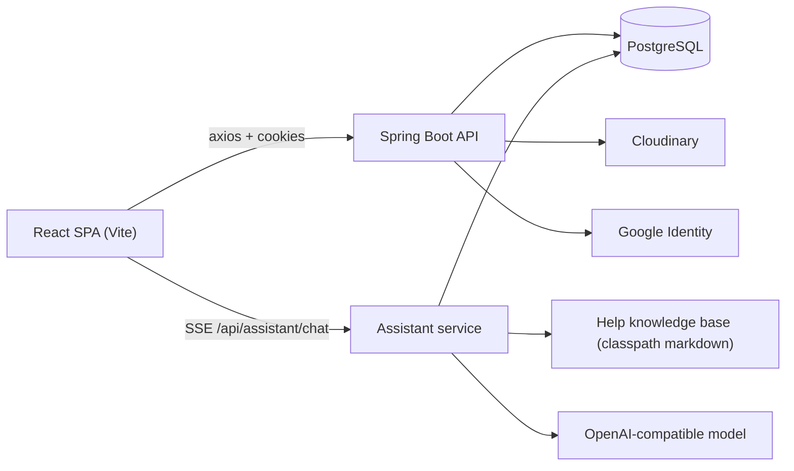

# besideCoding

A coding-practice platform for interview preparation: a searchable problem bank, timed
contests with leaderboards, community discussions, progress tracking, an admin console, and
an in-app assistant that can explain the site or coach you through a problem.

The repository contains two applications:

| Folder | What it is |
| --- | --- |
| `besideCoding_react` | Single-page client built with React 19, Vite and Tailwind CSS 4 |
| `besideCoding_springboot` | REST + SSE API built with Spring Boot 3.5 on Java 17 |

## Features

- **Problems** - browse with category, topic, company and search filters; multiple-choice and
  integer answers; likes/dislikes; written solutions.
- **Contests** - active, upcoming and past contests, join/end participation, contest
  submissions, leaderboards and post-contest solutions.
- **Discussions** - posts in four categories (Question, Article, Contest, Interview).
- **Profile** - editable details and avatar, solved counts per difficulty, submissions by
  language, recent activity.
- **Contribute** - submit new problems for admin review.
- **Admin** - dashboard statistics, users, problems, contests and reports.
- **Ask Beside** - streaming assistant for site help and problem hints, with a server-enforced
  contest lock.

## Tech stack

| Layer | Choice |
| --- | --- |
| Client | React 19, React Router 7, Vite 6, Tailwind CSS 4, axios, Zustand, Recharts, SweetAlert2 |
| API | Spring Boot 3.5, Spring Web, Spring Data JPA, Spring Security, Lombok |
| Database | PostgreSQL (`ddl-auto=none`, schema must already exist) |
| Auth | Username/password or Google, session cookie (`HttpSession`) |
| Media | Cloudinary for profile pictures |
| AI | Any OpenAI-compatible chat-completions endpoint, called over HTTP with SSE streaming |

## Architecture



The client talks to the API with the session cookie (`withCredentials: true`). The assistant
streams answers over server-sent events; the token never reaches the browser.

## Repository layout

```
besideCoding_react/
  src/
    pages/            problem, contest, discussion and profile pages
    admin/            admin dashboard and management screens
    components/       navbar, dropdowns, AssistantPanel, auth helpers
    layouts/          user and admin shells
  vite.config.js
besideCoding_springboot/
  src/main/java/com/example/besideCoding/
    problem/ contest/ contestparticipation/ contestsubmission/
    discussion/ submission/ profile/ signup/ dashboard/
    assistant/        Ask Beside: controller, service, retrieval, model client
  src/main/resources/
    application.properties.example
    assistant/kb/     help pages the assistant retrieves from
  src/test/java/      unit tests for the help retrieval
```

## Getting started

### Prerequisites

- JDK 17 or newer
- Node.js 18 or newer
- PostgreSQL 13+ (local instance or a managed one)

### 1. Database

The API runs with `spring.jpa.hibernate.ddl-auto=none` and the repository contains **no
migrations**, so it expects an existing schema. The tables it maps are:

`users`, `problems`, `problem_like`, `problem_submitted`, `contests`, `contest_problem`,
`contest_participant`, `contest_submission`, `discussions`.

Create those tables with your own tooling before starting the API.

### 2. API

```bash
cd besideCoding_springboot
cp src/main/resources/application.properties.example src/main/resources/application.properties
# edit the copy: datasource, Cloudinary, Google client id, assistant key
./mvnw spring-boot:run
```

The API listens on `http://localhost:8080`. `GET /health` returns `{"status":"UP"}`.

`application.properties` is ignored by git. Every value can also be supplied as an environment
variable instead:

| Property | Environment variable |
| --- | --- |
| `spring.datasource.url` | `SPRING_DATASOURCE_URL` |
| `spring.datasource.username` | `SPRING_DATASOURCE_USERNAME` |
| `spring.datasource.password` | `SPRING_DATASOURCE_PASSWORD` |
| `cloudinary.cloud_name` | `CLOUDINARY_CLOUD_NAME` |
| `cloudinary.api_key` | `CLOUDINARY_API_KEY` |
| `cloudinary.api_secret` | `CLOUDINARY_API_SECRET` |
| `google.client.id` | `GOOGLE_CLIENT_ID` |
| `assistant.api-key` | `ASSISTANT_API_KEY` |

### 3. Client

```bash
cd besideCoding_react
npm install
echo "VITE_API_BASE_URL=http://localhost:8080/" > .env
npm run dev
```

The client is served on `http://localhost:5173`.

> `VITE_API_BASE_URL` **must end with a slash**. Most calls are written as
> `${API_BASE_URL}api/...`, so a value without the slash produces `http://localhost:8080api/...`.

`server.servlet.session.cookie.secure=true` is set in the example configuration, which requires
HTTPS. Browsers treat `http://localhost` as a secure context, so local development works, but
plain HTTP on a remote host will not keep the session.

## Ask Beside

A floating panel in the bottom-right corner of every signed-in page. It answers two kinds of
questions:

1. **How the site works** - editing a profile, changing an avatar, submitting an answer, joining
   a contest, contributing a problem.
2. **The problem that is open** - what the statement is asking and progressive hints.

How it works:

- The help corpus lives in `src/main/resources/assistant/kb/*.md`, is split on `##` headings and
  ranked in memory with a small lexical scorer. No vector database or embedding provider is
  required.
- The problem context contains the statement and metadata only. The stored answer key and the
  written solution are never placed in the prompt.
- Answers stream over `POST /api/assistant/chat` as SSE events: `meta`, `token`, `blocked`,
  `error`, `done`.
- Conversation history is kept in the browser and sent with each request; the API is stateless.

### Contest lock

| Situation | Site questions | Problem hints | Written solution |
| --- | --- | --- | --- |
| No live contest | yes | yes | yes |
| Problem belongs to a live contest | yes | blocked | `403` |
| User is taking part in a live contest | yes | blocked anywhere in the app | depends on the problem |
| Contest finished | yes | yes | yes |

The rule is enforced on the server: `ContestLockService` checks the contest window, and hint
requests are refused before the model is called. The written solution is served by
`GET /api/problems/{id}/solution`, which returns `403` while the problem is contest-locked, and
the public problem payload no longer includes it.

### Assistant configuration

| Property | Default | Meaning |
| --- | --- | --- |
| `assistant.enabled` | `true` | Master switch |
| `assistant.api-key` | empty | Provider key; the panel reports "not configured" while empty |
| `assistant.base-url` | `https://api.openai.com/v1` | Any OpenAI-compatible base URL |
| `assistant.model` | `gpt-4o-mini` | Chat model |
| `assistant.max-tokens` | `700` | Response cap |
| `assistant.max-history-messages` | `8` | Turns sent back to the model |
| `assistant.requests-per-hour` | `30` | Per-user limit, in memory |

`GET /api/assistant/status` reports whether the assistant is enabled and configured.

## API overview

All routes are prefixed with `/api` unless noted.

| Area | Routes |
| --- | --- |
| Auth | `POST /signup`, `POST /signin`, `POST /auth/google`, `GET /session-user`, `POST /logout` |
| Profile | `GET /profile/{userId}`, `POST /profile/edit` |
| Problems | `GET /problems`, `GET /problems/{id}`, `GET /problems/{id}/solution`, `GET /problems/{id}/interactions`, `POST /problems/{id}/interact`, `POST /problems/contribute`, `GET /problems/sub-categories`, `GET /problems/companies`, `GET /problems/counts-by-difficulty` |
| Submissions | `POST /submit` |
| Contests | `GET /contests/active`, `/contests/upcoming`, `/contests/past`, `/contests/{id}`, `/contests/{id}/problems`, `/contests/{id}/problem/{index}`, `/contests/{id}/leaderboard`, `/contests/{id}/submissions`, `POST /submit-contest` |
| Participation | `POST /contest-participant/join`, `POST /contest-participant/end`, `GET /contest-participant/status` |
| Discussions | `GET /discussions`, `POST /discussions`, `POST /discussions/filter`, `GET /discussions/newest`, `/discussions/most-liked`, `/discussions/type/{type}` |
| Admin | `GET /admin/dashboard/insights`, `GET /admin/users`, `GET /admin/contest/all`, `POST /admin/contest/create` |
| Assistant | `POST /assistant/chat` (SSE), `GET /assistant/status` |
| Health | `GET /health` |

## Development

```bash
# API build
cd besideCoding_springboot && ./mvnw -DskipTests compile

# API unit tests (no database needed)
./mvnw -Dtest=KnowledgeBaseTest test

# Client build and lint
cd besideCoding_react && npm run build && npm run lint
```

The Spring context test (`BesideCodingApplicationTests`) needs a reachable database configured,
so the full `./mvnw test` only passes with one available.

## Deployment

- **API**: `besideCoding_springboot/Dockerfile` builds a jar and runs it on port 8080, which fits
  Render or any container host. Provide the environment variables above. The Dockerfile still uses
  the end-of-life `openjdk:17-jdk-slim` base image and should move to `eclipse-temurin:17-jre`.
- **Client**: build with `npm run build` and host `dist/` on Vercel or similar. Set
  `VITE_API_BASE_URL` at build time, with the trailing slash.
- **CORS**: `config/SecurityConfig.java` holds the allowlist and currently includes
  `https://beside-coding.vercel.app` plus the local dev origins. Add your own origin there.
- **Cookies**: cross-site sessions need `SameSite=None; Secure`, so the frontend must be served
  over HTTPS.

## Security notes

- Keep credentials in environment variables. Rotate any key that has ever been committed.
- This is not hardened for public production use yet: admin authorization, password hashing and
  request rate limiting still need work.

## Known limitations

- No schema migrations; the database is managed by hand.
- `VITE_API_BASE_URL` hygiene as described above; `pages/Problem.jsx` is the file that depends on
  it most directly.
- The admin dashboard reports a hardcoded total-submission count.
- Discussion creation posts a fixed user id.
- The assistant's hourly limit is per process, so it resets on restart and is not shared across
  instances.
- Contests are locked based on their configured window and `visible` flag; drafts are ignored.

## Contributing

Create a branch from `master`, keep changes focused, and make sure the API compiles, the client
builds and the unit tests pass before opening a pull request.

No license file is included in this repository.
